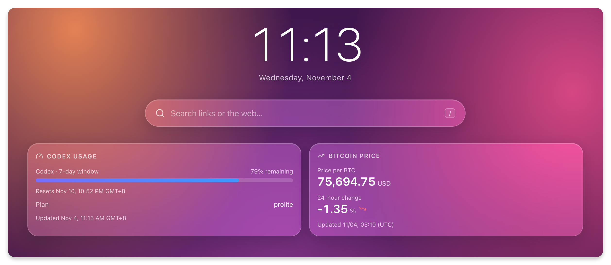

# Genkan Plugins

English | [简体中文](README.zh-CN.md)

A collection of plugins for [Genkan](https://github.com/jae-jae/genkan).



## Plugins

| Plugin | Description |
| --- | --- |
| [Codex Usage](plugins/codex-usage.js) | Shows your Codex subscription allowance, reset times, plan and available credits. Supports English and Chinese; refreshes every 5 minutes. |
| [Bitcoin Price](plugins/bitcoin-price.js) | Shows the Bitcoin price in USD or CNY, 24-hour change and update time. Supports English and Chinese; refreshes every 5 minutes. |
| [Stock Trend](plugins/stock-trend.js) | Shows index or stock quotes, daily changes and a price chart for the past day, month or year. Defaults to the Nasdaq Composite; supports English and Chinese; refreshes every 5 minutes. |
| [SSH Server](plugins/ssh-server.js) | Native SSH metrics for Linux: CPU, memory, root disk, network rates and history, refreshed every 30 seconds. Requires a Genkan build with SSH support. |
| [Subscription Usage](plugins/subscription-usage.js) | Hourly subscription snapshots, 7/30-day trends and observed daily increases with verified TLS. |

## Install

1. In Genkan, open **Settings → Plugins → Add → Third-party** and search for `genkan-plugins`.
2. Install a plugin and fill in its settings.
3. Enable it and add its widget to your page.

You can also install Codex Usage using this URL:

```text
https://raw.githubusercontent.com/jae-jae/genkan-plugins/main/plugins/codex-usage.js
```

Bitcoin Price installation URL:

```text
https://raw.githubusercontent.com/jae-jae/genkan-plugins/main/plugins/bitcoin-price.js
```

Stock Trend installation URL:

```text
https://raw.githubusercontent.com/jae-jae/genkan-plugins/main/plugins/stock-trend.js
```

SSH Server installation URL (requires a Genkan build with native SSH support):

```text
https://raw.githubusercontent.com/jae-jae/genkan-plugins/main/plugins/ssh-server.js
```

Subscription Usage local installation (requires a Genkan build with `verifyTLS` support): install the source file [plugins/subscription-usage.js](plugins/subscription-usage.js). This plugin has not been published by this task.

## Codex Usage settings

- **Access token:** After signing in to Codex with ChatGPT, copy the value at `~/.codex/auth.json → tokens.access_token`. Paste only the value, without quotes or other fields. Replace it when it expires. This is an account credential; keep it private and use a trusted Genkan instance.
- **Account ID:** Optional. Leave blank to use the account in the token.
- **Widget options:** Choose remaining or used allowance and a time zone. Defaults: remaining allowance, `Asia/Shanghai`.

The widget shows the quota windows returned by Codex. It queries only `chatgpt.com:443` and does not request bookmark permissions. It does not track ChatGPT chat messages or OpenAI API billing.

## Bitcoin Price settings

- **Quote currency:** USD by default; choose CNY in the widget settings to show the price in Chinese yuan.
- No API key is required. Prices and 24-hour changes come from CoinPaprika; update times are shown in UTC.

The plugin queries only `api.coinpaprika.com` and does not request bookmark permissions. It caches prices for 5 minutes. If a refresh fails, it shows the last saved price with a warning for up to one hour after the provider's update time. Older data produces an error instead of a price; provider data over 10 minutes old is marked as stale.

## Stock Trend settings

- **Ticker symbol:** Defaults to `^IXIC` (Nasdaq Composite). Use Yahoo Finance symbols such as `^NDX` (Nasdaq 100), `AAPL` or `MSFT` for other instruments.
- **Display name:** Optional. Leave blank to use the ticker or known index name.
- **Default chart period:** The past month by default; choose the past day, month or year. Administrators can also switch periods on the card. A one-day chart shows the latest available trading session.
- No API key is required. Quote times are shown in UTC, and prices may be delayed. Daily changes use the previous trading day's close, independently of the chart period. Chart colors follow the selected period's first-to-last price; prices are not adjusted for splits or dividends.

The plugin queries only `query1.finance.yahoo.com` and `query2.finance.yahoo.com`, with no bookmark permissions or embedded third-party pages. It caches one quote and chart per widget for 5 minutes. If a request fails, it can show the saved data for the same ticker and period with a cache-time warning; there is no maximum age for this fallback. Yahoo Finance's public chart endpoint may change or rate-limit requests.

## SSH Server settings

Requires a Genkan build with native SSH support; older versions show an upgrade message. Add one widget per Linux server. No remote agent or sudo is needed.

- **Host:** A hostname or IP reachable from the Genkan server, without a scheme or port. Omit brackets for IPv6 addresses.
- **Port:** Defaults to `22`.
- **User:** An SSH user that can read `/proc` and the root filesystem's disk usage.
- **Password or private key:** Supply one authentication method. Paste the complete PEM/OpenSSH private key and provide its passphrase if encrypted. Clear the previous credential when switching methods. Saved credentials are not displayed again; they use Genkan's existing storage without additional encryption at rest.
- **Display name:** Optional. Leave blank to use the server hostname.

The plugin requests SSH resource-collection permission, with no HTTP or bookmark access. It connects directly without confirming or verifying the server host key. Each collection runs a fixed read-only script with a 7-second timeout.

The widget shows Linux CPU, memory, root filesystem usage and combined network rates. Container quotas and other mount points are not covered; bridge and virtual interfaces may cause network traffic to be counted more than once. CPU history starts with the second sample and keeps up to 60 samples over 30 minutes while the page polls the widget. Connection failures can show saved readings for up to five minutes, marked with their sample time; authentication failures show an error instead.

## Subscription Usage settings

`plugins/subscription-usage.js` reads `Subscription-Userinfo` headers and records hourly snapshots. It supports up to five independent widget instances, English/Chinese, 7/30-day cumulative charts and observed daily increases. The widget reads saved data every five minutes; opening the page does not fetch subscriptions.

**Host requirement:** Genkan must support `ConfigField.verifyTLS` and expose `genkan.capabilities.verifyTLS === true`. Older hosts show an upgrade message and make no requests. Deploy the corresponding host change with this plugin; it never falls back to unverified TLS.

In plugin settings, fill one of **Allowed origin 1–5** with an HTTPS origin (scheme, host and optional port only). Do not include credentials, paths, queries or fragments. In each widget, select that origin and put the full private subscription URL in the **secret** Subscription URL field. Its origin must match. Select a display name, 7/30-day range and IANA time zone (default `Asia/Shanghai`). Changing the URL, including a token rotation, or the time zone starts a new history. Only the first five instances in ID order are sampled; additional widgets show a limit message.

All configured origins use strict certificate verification, with no bookmark permissions or wildcard network access. Requests use `User-Agent: clash.meta`: HEAD first, then one GET if HEAD is unsupported or lacks usable counters. The GET body is canceled without reading node configurations. Redirects are refused: use the final HTTPS endpoint. Authentication failures and rate limits are not immediately retried. One failed subscription does not stop the others.

Used bytes are `upload + download`; missing or invalid counters do not produce a sample. Missing quota is unknown; `total=0` means unlimited. Missing/zero expiration is unknown. Overages, expiry and stale data are indicated. A failed refresh preserves the last successful snapshot and its time; data is also marked stale after two hours without a successful sample.

The cumulative chart represents reported counter snapshots, split at decreases, failed observations or gaps over 90 minutes, showing at most the latest three segments. Daily bars sum only consecutive, non-reset observations within the same local date. Intervals crossing midnight, gaps and reset intervals are excluded, never interpolated or allocated across dates. Dates marked `*` are partial observations; dates with no observed interval are omitted, not filled with zero. The latest observed day shows covered hours and interval count. **These are not precise billing totals, and history before installation cannot be recovered.**

History is isolated by widget ID. URLs are never used as keys or stored in history; only a SHA-256 source identity and numeric state are saved. Retention is seven days of hourly detail and 30 days of daily summaries, capped at 40 KiB per instance and 200 KiB across five instances. Deleted or over-limit instance history is cleaned up on the next schedule. Sampling pauses while Genkan or the plugin is stopped. Visitors with page access can see usage cards; configure guest access accordingly.

Run `npm test` for offline tests. `npm run test:host` also verifies the plugin inside the sibling `../genkan` checkout using a Go overlay, without writing tests into that checkout. For another host location use `node tests/run-host-tests.mjs /path/to/genkan`. Host integration uses temporary loopback HTTPS services and test certificates, with no real subscription credentials or Genkan token.

## Add a plugin

Add its JavaScript file to `plugins/`, register it in `genkan-plugins.json`, and update both READMEs. See the [Genkan plugin guide](https://github.com/jae-jae/genkan/blob/main/skills/genkan/plugin-dev.md).

Run tests with Node.js 22 or later:

```bash
npm test
```
