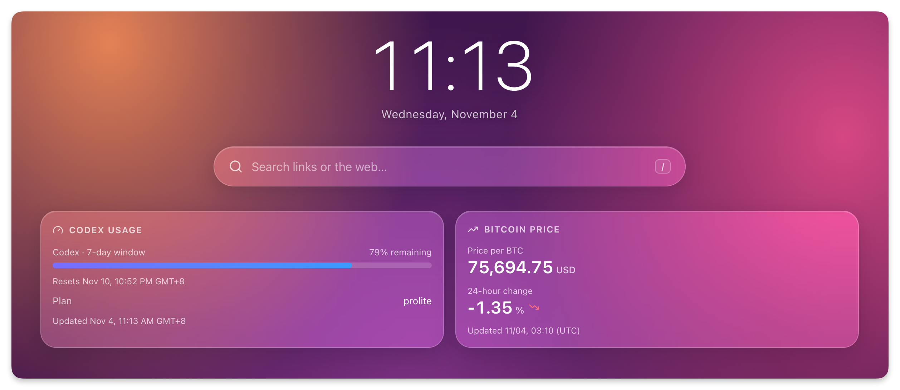

# Genkan 插件

[English](README.md) | 简体中文

用于 [Genkan](https://github.com/jae-jae/genkan) 的插件集合。



## 插件

| 插件 | 介绍 |
| --- | --- |
| [Codex 用量](plugins/codex-usage.js) | 显示 Codex 订阅额度、重置时间、套餐和可用点数，支持中英文，每 5 分钟刷新。 |
| [比特币价格](plugins/bitcoin-price.js) | 显示比特币的美元或人民币价格、24 小时涨跌幅和更新时间，支持中英文，每 5 分钟刷新。 |
| [股票走势](plugins/stock-trend.js) | 显示指数或个股行情、日涨跌和最近一天／一个月／一年的走势图，默认纳斯达克综合指数，支持中英文，每 5 分钟刷新。 |

## 安装

1. 在 Genkan 中打开「设置 → 插件 → 添加 → 第三方」，搜索 `genkan-plugins`。
2. 安装插件，填写插件设置。
3. 启用插件，将小组件添加到页面。

也可以通过以下地址安装 Codex 用量：

```text
https://raw.githubusercontent.com/jae-jae/genkan-plugins/main/plugins/codex-usage.js
```

比特币价格的安装地址：

```text
https://raw.githubusercontent.com/jae-jae/genkan-plugins/main/plugins/bitcoin-price.js
```

股票走势的安装地址：

```text
https://raw.githubusercontent.com/jae-jae/genkan-plugins/main/plugins/stock-trend.js
```

## Codex 用量设置

- **访问令牌：** 使用 ChatGPT 登录 Codex 后，从 `~/.codex/auth.json → tokens.access_token` 复制字段值。只粘贴值，不要带引号或其他字段，过期后重新填写。这是账户凭据，请妥善保管，仅用于可信的 Genkan 实例。
- **账户 ID：** 选填，留空使用令牌中的账户。
- **小组件选项：** 可切换剩余或已用额度，并设置时区。默认显示剩余额度，时区为 `Asia/Shanghai`。

小组件按 Codex 实际返回的额度窗口显示数据，仅请求 `chatgpt.com:443`，不申请书签权限。它不统计 ChatGPT 聊天消息数量或 OpenAI API 账单。

## 比特币价格设置

- **计价货币：** 默认显示美元价格，可在小组件设置中切换为人民币。
- 无需 API 密钥。价格及 24 小时涨跌幅来自 CoinPaprika，行情更新时间使用 UTC。

插件仅请求 `api.coinpaprika.com`，不申请书签权限，价格缓存 5 分钟。刷新失败时，会显示上次保存的价格并提示，但只保留数据源更新时间起一小时内的价格；超过一小时后显示错误。数据源超过 10 分钟未更新时会标注。

## 股票走势设置

- **股票或指数代码：** 默认 `^IXIC`（纳斯达克综合指数），也可填写 Yahoo Finance 代码，例如 `^NDX`（纳斯达克100指数）、`AAPL` 或 `MSFT`。
- **显示名称：** 选填，留空时使用股票代码或已知指数名称。
- **默认图表周期：** 默认最近一个月，可选择最近一天、一个月或一年。管理员也可直接点击卡片上的周期按钮。「1月」表示最近一个月，一日图显示最近可用交易时段。
- 无需 API 密钥。行情时间使用 UTC，价格可能延迟。日涨跌始终相对前一交易日收盘价计算，与图表周期无关；折线颜色反映所选区间首尾的价格方向，价格未做拆股或分红复权。

插件仅请求 `query1.finance.yahoo.com`、`query2.finance.yahoo.com`，不申请书签权限，不嵌入第三方网页。每个小组件缓存一份行情和走势，5 分钟内复用。请求失败时，可显示相同标的和周期的缓存并标注获取时间；此回退没有最大缓存年龄限制。Yahoo Finance 公开行情接口可能变更或限流。

## 添加插件

将 JavaScript 文件放入 `plugins/`，在 `genkan-plugins.json` 中登记，并更新两份 README。开发方式见 [Genkan 插件指南](https://github.com/jae-jae/genkan/blob/main/docs/PLUGIN_DEV.md)。

使用 Node.js 22 或更高版本运行测试：

```bash
npm test
```
